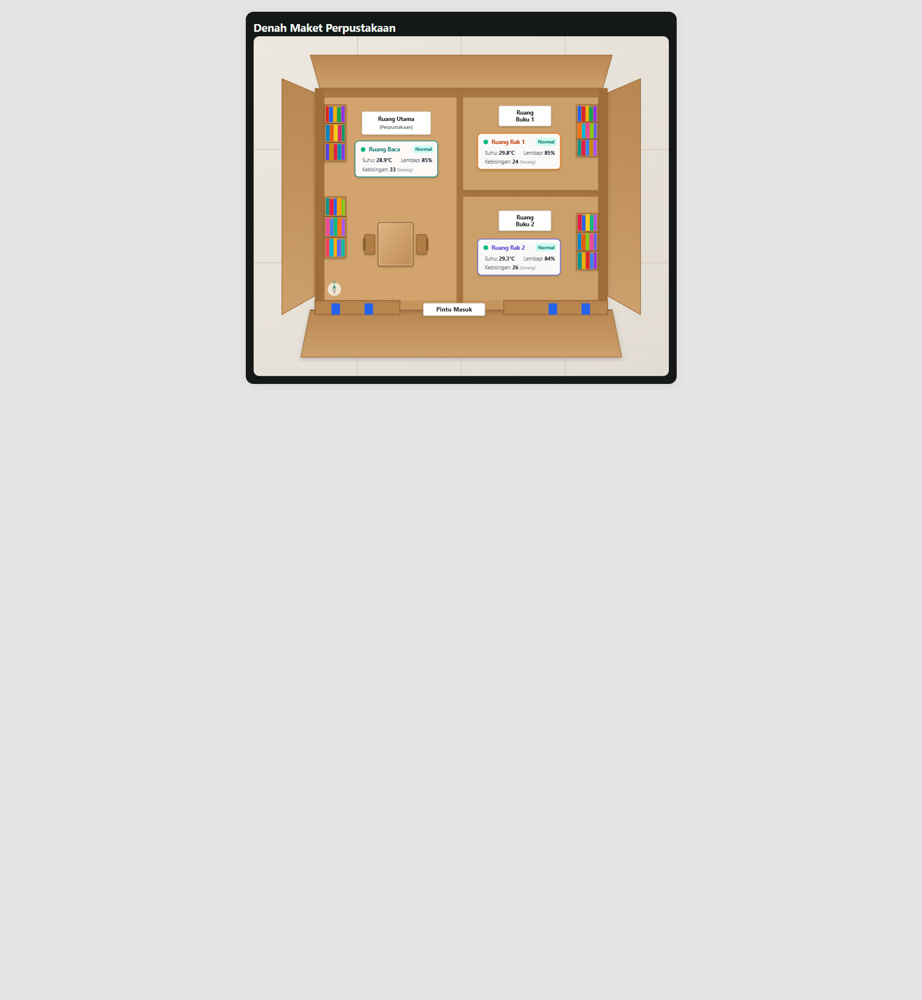
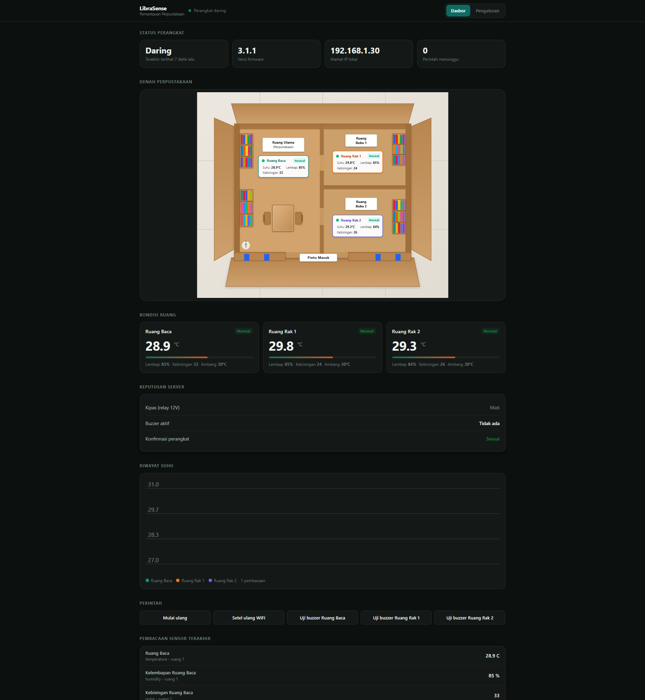

<div align="center">

# LibraSense

**Smart IoT Library Environmental Monitoring and Automation System**

Sistem pemantauan lingkungan perpustakaan waktu-nyata (real-time) berbasis IoT untuk menjaga kenyamanan ruang baca dan preservasi buku pada rak koleksi. Menggunakan mikrokontroler ESP32, single binary backend berbasis Go dengan embedded SQLite, serta panel dasbor interaktif Alpine.js yang dilengkapi visualisasi denah maket perpustakaan.

---

[](https://golang.org/)
[](https://www.espressif.com/)
[](https://alpinejs.dev/)
[](https://gitlab.com/cznic/sqlite)
[](https://www.cloudflare.com/products/zero-trust/)
[](https://podman.io/)

</div>

---

## Visualisasi Denah Maket Interaktif

Panel LibraSense dilengkapi denah vektor SVG presisi tinggi yang mereplikasi maket fisik kardus 3 ruangan:
- **Ruang Utama (Ruang Baca)**: Dilengkapi rak buku, meja baca, dan kursi belajar.
- **Ruang Rak Buku 1 dan 2**: Dua ruangan khusus penyimpanan koleksi buku.
- **Live Telemetry HUD**: Setiap ruangan menampilkan suhu, kelembapan, status kebisingan secara langsung, dan merespons kondisi anomali (peringatan berisik atau suhu panas) secara visual.

<div align="center">
  
  <p><em>Representasi visual denah maket perpustakaan dengan overlay telemetri per ruangan</em></p>
</div>

<br/>

<div align="center">
  
  <p><em>Dasbor lengkap LibraSense: Kartu per ruangan, Denah interaktif maket, Grafik riwayat suhu, dan Kontrol Aktuator</em></p>
</div>

---

## Fitur Utama

- **Pemisahan Peran Tegas (Decoupled IoT Architecture)**:
  - ESP32 murni membaca sensor (DHT11 dan KY-037) dan mengeksekusi perintah aktuator.
  - Server Go menjadi otak tunggal penentu keputusan (decision engine) untuk histeresis suhu, kendali kipas, dan aktivasi alarm buzzer.
- **Single Static Binary**:
  - Backend ditulis dengan Go murni (`CGO_ENABLED=0` memakai `modernc.org/sqlite`).
  - Seluruh aset web panel (HTML, CSS, JS, SVG, Alpine.js) di-bundle langsung ke dalam binary server menggunakan `//go:embed`.
- **Zero Frontend Build Step**:
  - Menggunakan native CSS Variables dan Alpine.js statis tanpa node_modules, npm, Vite, atau build tools eksternal.
- **Proteksi Berlapis**:
  - Endpoint perangkat (`/device/*`) diproteksi **Bearer Token** acak.
  - Endpoint panel (`/api/*`) diamankan verifikasi **Cloudflare Access JWT (Zero Trust)**.
- **Denah Maket Reaktif**:
  - Status lantai ruangan otomatis berubah warna dan memunculkan badge peringatan saat suhu atau kebisingan melewati ambang batas.

---

## Arsitektur Sistem

```text
 +----------------------------------------+
 |        ESP32 Sensor Node (Firmware)    |
 |   - 3x DHT11 (Suhu dan Kelembapan)     |
 |   - 3x KY-037 (Sensor Kebisingan)      |
 |   - 1x Relay 12V Kipas Pendingin       |
 |   - 3x Active Buzzer                   |
 |   - 1x LCD 16x2 I2C Display            |
 +-------------------┬--------------------+
                     | HTTP POST /device/readings (Bearer Token)
                     v
 +----------------------------------------+
 |           LibraSense Go Server         |
 |   - internal/decision (Logic Engine)   |
 |   - internal/store    (SQLite WAL)     |
 |   - internal/httpapi  (REST API)       |
 +-------------------┬--------------------+
                     | Server-Side State & Embedded Panel
                     v
 +----------------------------------------+
 |        Interactive Web Dashboard       |
 |   - Denah Maket Perpustakaan SVG       |
 |   - Kartu Telemetri 3 Ruangan          |
 |   - Grafik Riwayat Suhu SVG            |
 |   - Pengaturan Ambang dan Uji Manual   |
 +----------------------------------------+
```

---

## Komponen Perangkat Keras

| No | Komponen | Jumlah | Fungsi |
|:--:|---|:--:|---|
| 1 | **ESP32 Development Board (30-pin)** | 1 unit | Mikrokontroler utama pemrosesan sensor |
| 2 | **ESP32 Expansion Board** | 1 unit | Distribusi daya dan ekspansi GPIO |
| 3 | **DHT11 Sensor Module** | 3 unit | Sensor suhu dan kelembapan di 3 ruang |
| 4 | **KY-037 Sound Sensor Module** | 3 unit | Sensor tingkat kebisingan di 3 ruang |
| 5 | **Single Channel Relay 5V** | 1 unit | Sakelar kontrol daya kipas pendingin 12V |
| 6 | **DC Cooling Fan 12V** | 1 unit | Sirkulasi udara pendingin rak |
| 7 | **LCD Character 16x2 I2C** | 1 unit | Display status luring di dekat maket |
| 8 | **Active Buzzer** | 3 unit | Alarm peringatan kebisingan atau suhu per ruang |

---

## Struktur Direktori

```text
├── cmd/librasense/          # Main entrypoint server Go
├── internal/
│   ├── config/              # Parser konfigurasi environment dan validasi
│   ├── decision/            # Decision engine (evaluasi ambang, histeresis, kipas, buzzer)
│   ├── httpapi/             # Routing HTTP, auth Cloudflare Access, handler API dan Device
│   ├── settings/            # Definisi batas nilai konfigurasi dan default
│   └── store/               # Engine SQLite, migrasi schema, query telemetri
├── web/                     # Panel web mandiri (HTML, CSS, JS, SVG, Alpine.js)
├── esp32/librasense_node/   # Kode firmware mikrokontroler (Arduino C++)
├── deploy/                  # Skrip deployment otomatis, Containerfile, systemd unit
├── docs/                    # Dokumentasi teknis, jurnal rekayasa, dan aset
└── README.md
```

---

## Menjalankan Secara Lokal

### Prasyarat
- Go 1.22 atau lebih baru
- Arduino IDE atau `arduino-cli` (untuk flash ESP32)

### 1. Kompilasi Server
```bash
go build -o bin/librasense ./cmd/librasense
```

### 2. Jalankan Mode Development
Buat file environment lokal atau jalankan langsung di terminal:

```powershell
$env:APP_ENV="development"
$env:PORT="8787"
$env:DATA_DIR="./data"
$env:DEVICE_ID="perpustakaan-1"
$env:DEVICE_TOKEN="debugtoken1234567890"
$env:ACCESS_DEV_BYPASS="true"

.\bin\librasense.exe
```

Buka peramban di `http://127.0.0.1:8787` untuk melihat dasbor.

> *Catatan: `ACCESS_DEV_BYPASS=true` hanya berfungsi saat `APP_ENV=development`. Pada mode produksi (`APP_ENV=production`), server menolak bypass ini.*

---

## Spesifikasi REST API

| Metode | Endpoint | Autentikasi | Deskripsi |
|:---:|---|:---:|---|
| `GET` | `/health` | Publik | Cek kesehatan server dan status database |
| `POST` | `/device/readings` | Bearer Token | Ingest telemetri dari ESP32 dan respons perintah aktuator |
| `POST` | `/device/ack` | Bearer Token | Konfirmasi eksekusi perintah dari ESP32 |
| `GET` | `/api/overview` | CF Access JWT | Ringkasan telemetri, status sensor, dan aktuator untuk panel |
| `GET` | `/api/history` | CF Access JWT | Data riwayat suhu untuk visualisasi grafik |
| `PUT` | `/api/settings` | CF Access JWT | Perbarui ambang batas suhu dan kebisingan |
| `POST` | `/api/commands` | CF Access JWT | Kirim perintah ke node (`restart`, `test1`, `test2`, `test3`) |

---

## Deployment Produksi

Deployment ke VPS menggunakan skrip otomatis yang tersedia di direktori `deploy/`:

```powershell
# Uji kesiapan host VPS
.\deploy\check-vps.ps1

# Kompilasi lintas platform dan deploy ke Podman container
.\deploy\deploy.ps1 -Remote
```

Panduan operasional dan manajemen unit systemd dapat dilihat pada [deploy/README.md](deploy/README.md).

---

<div align="center">
  <sub>Dikembangkan untuk Proyek Sistem IoT Pemantauan Lingkungan Perpustakaan.</sub>
</div>
